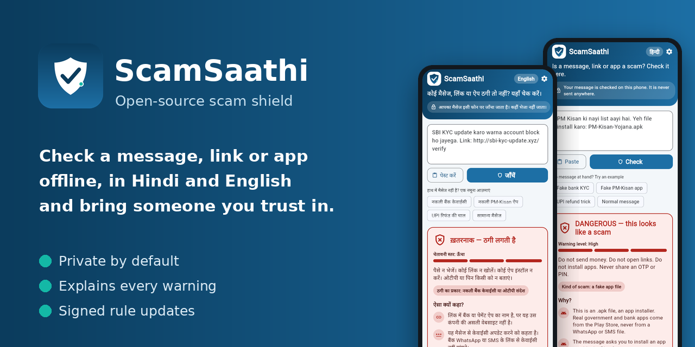
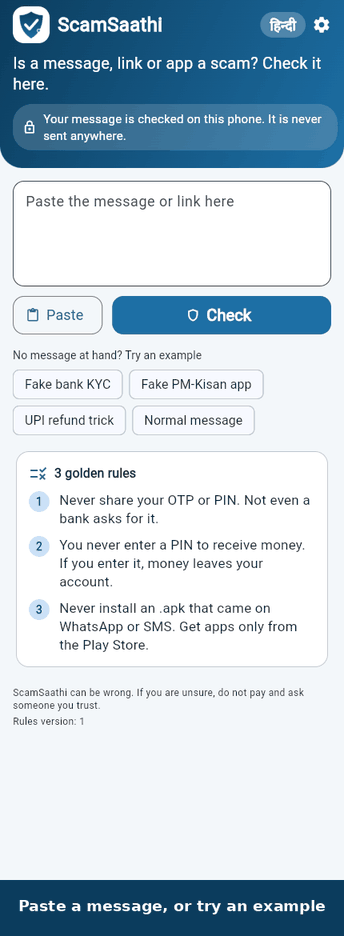
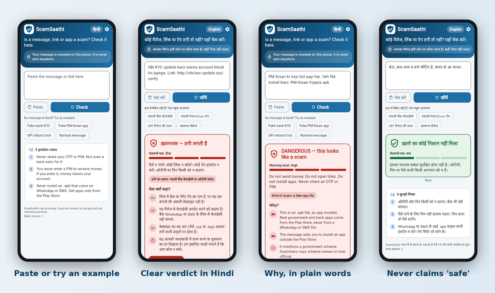

<p align="center">
  
</p>

<p align="center">
  <a href="https://github.com/nikhilrai-tech/ScamSaathi/actions/workflows/ci.yml"></a>
  <a href="LICENSE"></a>
  <a href="https://github.com/nikhilrai-tech/ScamSaathi/releases"></a>
  <a href="https://nikhilrai-tech.github.io/ScamSaathi/"></a>
  
</p>

# ScamSaathi

**A scam shield for the people scammers target most: farmers, students and their families. It checks a message, link or app
name on the phone itself, in Hindi or English, explains *why*, and can tell someone you trust.**

> **Pre-alpha.** It works and is tested, but it is not ready to protect anyone yet: the Android app has not been run on a real
> phone, accuracy on real messages has not been measured, and nothing is deployed. Treat every result as a hint for a
> human, never as proof. If you lost money, call **1930** or report at [cybercrime.gov.in](https://cybercrime.gov.in).

<p align="center"></p>

## Try it

| | |
|---|---|
| **In your browser** (no install) | **[nikhilrai-tech.github.io/ScamSaathi](https://nikhilrai-tech.github.io/ScamSaathi/)**. The same screens and engine as the app; the check runs in the page and nothing is sent anywhere. Tap an example to start. |
| **Android** | Download the `.apk` from the [latest release](https://github.com/nikhilrai-tech/ScamSaathi/releases/latest) and check it against `SHA256SUMS`. It is a **test build signed with a debug key**, not on the Play Store, and untested on real devices. |
| **Command line** | `pipx install scamsaathi-engine` then `scamsaathi "SBI KYC update karo warna account block ho jayega. Link: http://sbi-kyc-update.xyz/verify"`. The package is built by the release workflow and will appear on PyPI after the maintainer enables publishing; until then install the wheel from the release. |
| **API** | `docker pull ghcr.io/nikhilrai-tech/scamsaathi-api` (published by the release workflow) or `docker compose up --build`, see [docs/API.md](docs/API.md). |

<p align="center"></p>

## Why

Every day people in India lose money to a fake "PM-Kisan.apk", an "RTO challan" file, a "KYC update" link, a UPI "collect
request" or a fake scholarship, and most of it arrives on WhatsApp or SMS in a regional language while the victim is alone.
Existing checkers are mostly English-first and cloud-based. ScamSaathi is built around three ideas that are hard to find
together (see the [honest market map](docs/MARKET.md), which also lists the projects that already exist):

1. **Share-to-check.** Share a message from WhatsApp or SMS to the app, or tap an example. The verdict comes with plain-language
   reasons, not just a label.
2. **Offline and private by default.** Detection runs on the phone from signed rule packs. The message is never uploaded.
   Reporting a scam is opt-in and sends only hashes of the link or UPI ID, never the message.
3. **The Saathi loop.** You can name someone you trust. When something looks dangerous the app writes them a short note that
   names the kind of scam and **never contains the message, a link or a number**.

On the institution side, a school, farmer-producer organisation or cooperative bank gets a district dashboard of what is
circulating and can publish verified alerts. Alerts cannot contain links.

## How it works

```
 WhatsApp / SMS --share--> [ Flutter app ] --verdict + reasons--> user
                              |   |   '--note (no message)--> trusted person (sent by the user)
              signed pack     |   '--(opt-in) hashes only--> [ Django API ] --> confirmed hashes (feed)
              (Ed25519)       v                                   |
                        Dart engine  <== same 36-case corpus ==>  Python engine
```

- **Rules are data.** `packs/core/pack.json` holds phrases, link features and weights, with every explanation in English and
  Hindi. A Dart and a Python engine must both pass the same golden corpus, so they cannot drift apart.
- **No single clue is enough.** One warning sign can never make a message "dangerous"; at least two must agree. Nothing is
  ever called "safe": a quiet result says "no warning signs found" and reminds you it is not a guarantee.
- **Signed updates, fail closed.** A pack is signed offline with Ed25519. The server and the app both reject a missing,
  tampered, wrongly signed or older pack.
- **Hard to poison.** A scam indicator needs 3 independent reporters or a verified organisation, real bank and government
  domains can never be reported, and admins can revoke.

More in [docs/ARCHITECTURE.md](docs/ARCHITECTURE.md) (threat model included).

## What is verified, and what is not

| | Status |
|---|---|
| Python engine, 62 tests; Dart engine, same corpus | Verified in CI |
| API, 32 tests including forged signatures, poisoning and link-filtering | Verified in CI |
| Flutter app: 69 tests, `flutter analyze`, web build, screenshots rendered from the real build | Verified in CI / locally |
| Docker image: built, ran as non-root, served a signed pack, refused an unsigned one | Verified locally |
| **Android app on a real phone** (share intent, SMS/WhatsApp/dialler launch) | **Not done** |
| **Detection accuracy on real messages** | **Not measured**; the corpus is small and made up |
| Deployed service, Play Store, iOS, Marathi, APK file analysis, voice | Not built |

## Repository

| Folder | What | Stack |
|---|---|---|
| [`packs/`](packs) | Rule pack, golden corpus, public signing key | JSON |
| [`engine/`](engine) | Reference engine and CLI (`scamsaathi-engine`) | Python |
| [`api/`](api) | Signed packs, hashed reports, organisations, alerts | Django REST framework |
| [`app/`](app) | The mobile and web app, with the same engine in Dart | Flutter |
| [`tools/`](tools) | Pack signing, brand and screenshot generators | Python, shell |

```bash
# engine
cd engine && pip install -e '.[dev]' && pytest
# API
cd api && pip install -r requirements.txt && SCAMSAATHI_DEBUG=1 python manage.py test
# app
cd app && flutter pub get && flutter test && flutter run -d chrome
```

After changing `packs/core/pack.json` run `tools/sync_assets.sh` (tests fail if a bundled copy drifts) and sign the pack
with `tools/packsign.py` at release time.

## Contributing

The most useful contributions are **new scam patterns, new languages (Marathi first) and false-alarm reports**, with made-up
examples only. See [CONTRIBUTING.md](CONTRIBUTING.md) and [SECURITY.md](SECURITY.md), and read the [roadmap](docs/ARCHITECTURE.md#roadmap).

## License

Apache License 2.0, see [LICENSE](LICENSE). The "ScamSaathi" name and logo are not yet trademark-checked.
